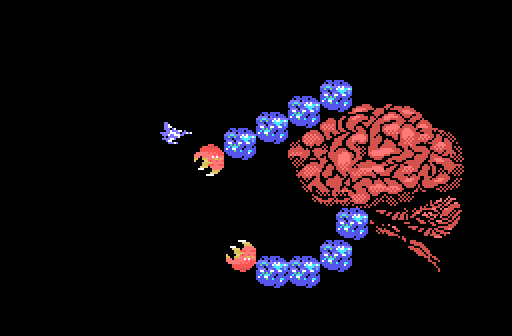

# The bosses

The bosses are painted with **the ROM's characters and patterns** over the layout of an openMSX dump (`tools/jefes.py`).

*Boss 1, a brain with two tentacles.*

The code of the eight bosses is in bank 11 (table `p01:6E89`). The
cartridge gives them no names: neither the English nor the Japanese texts
name any of them. The prophecy only speaks of «THE DEVIL» with his copper
shield, «THE HUGE SPHERE», «THE GREAT DEVIL» and his nucleus, and «THE FIVE
EYED GREEN DEVIL».

| Stage | Boss |
|---|---|
| 1 | [boss 1](imagenes/jefe_1.png): a brain with two tentacles |
| 2 | [boss 2](imagenes/jefe_2.png) |
| 3 | [boss 8](imagenes/jefe_8.png), a nest in the ceiling that drops spiders, then [boss 3](imagenes/jefe_3.png) |
| 4 | [boss 4](imagenes/jefe_4.png), after a wave (`p03:BD53`) |
| 5 | [boss 5](imagenes/jefe_5.png) |
| 6 | [boss 7](imagenes/jefe_7.png), an eye inside a sphere, then [boss 6](imagenes/jefe_6.png) |
| 7 | [the fixed core](imagenes/jefe_nucleo.png) at `p12:A000`, in two parts |
