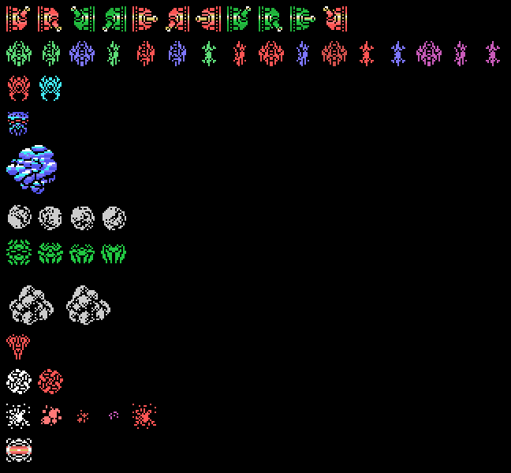
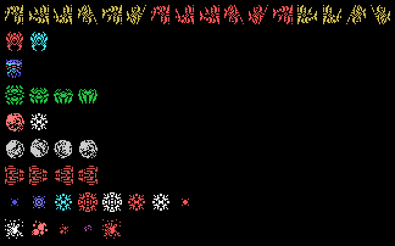
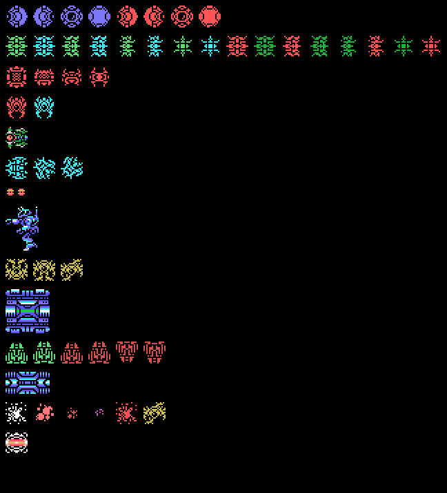
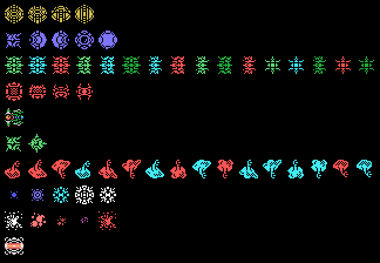
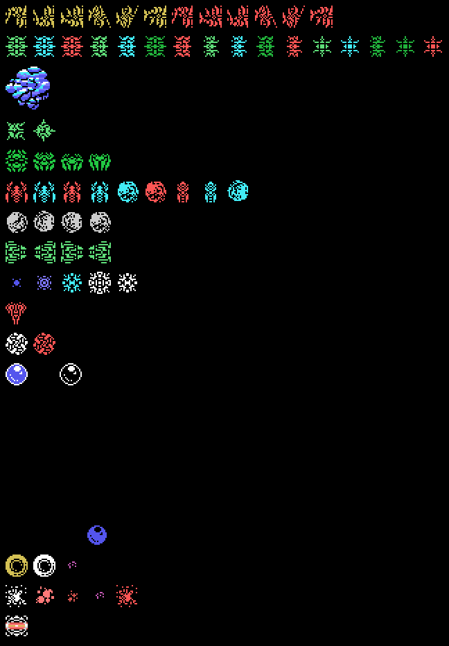
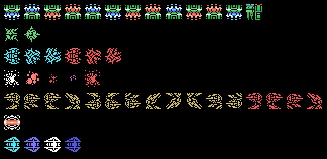

# The enemies

The enemies are painted with **the ROM's patterns** over what they do in openMSX (`tools/enemigos.py`).

There are 65 enemy types, each with a 7-byte record (`p01:6C5D`).

### Stage 1

### Stage 2

### Stage 3

### Stage 4

### Stage 5

### Stage 6

### Stage 7

