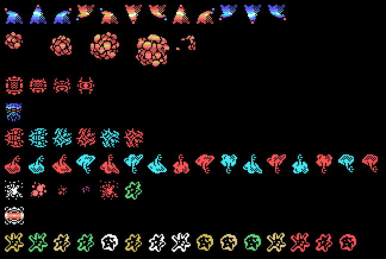

# The enemies

The enemies are painted with **the ROM's patterns** over what they do in openMSX (`tools/enemigos.py`).

*The stage 1 enemies, with the frames they use.*

There are 65 enemy types, each with a 7-byte record (`p01:6C5D`).

| Stage | 1 | 2 | 3 | 4 | 5 | 6 | 7 |
|---|---|---|---|---|---|---|---|
| Enemies | [stage 1](imagenes/enemigos_f1.png) | [stage 2](imagenes/enemigos_f2.png) | [stage 3](imagenes/enemigos_f3.png) | [stage 4](imagenes/enemigos_f4.png) | [stage 5](imagenes/enemigos_f5.png) | [stage 6](imagenes/enemigos_f6.png) | [stage 7](imagenes/enemigos_f7.png) |
