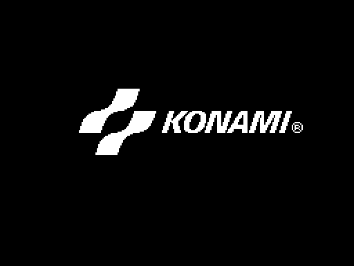
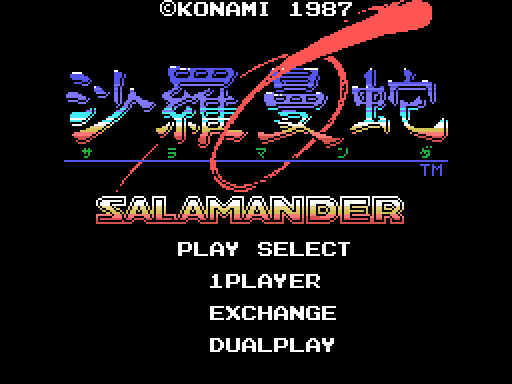
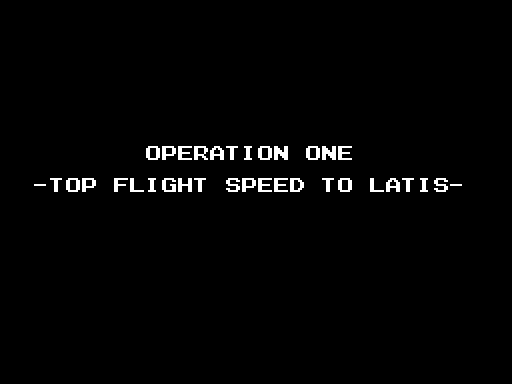

# The game

**Seven stages**. Stages 1 and 2 always come first; stages 3, 4 and 5, in
whatever order the player picks; then stage 6. Stage 7 only exists with
*Nemesis 2* in the other slot.

Every picture on this page is **drawn from the bytes of the ROM** with
`tools/imagenes.py`. The screens of the intro, the radar and the endings are
identical, pixel for pixel, to openMSX's VRAM at that moment; the enemies
and the bosses are painted with the ROM's patterns over what they do in
openMSX.

## The intro

*The title with the menu: 1PLAYER, EXCHANGE and DUALPLAY.*

Then come [THE SAGA CONTINUES](imagenes/saga.png),
[KONAMI PRESENTS](imagenes/presents.png) and
[the title on its own](imagenes/titulo_solo.png).

## The stages and their order

*The radar with the three planets.*

After stage 2, the game shows the radar with EIONEUS, LAVINIA and KIERKE,
and the player picks which one comes first: they are stages 3, 4 and 5, in
whatever order he chooses (`p10:988A`). There is a clock: if it reaches
zero, the game picks (`p10:9A43`). Stage 6 comes next. Stage 7, with
*Nemesis 2*, comes before stage 6 (`p10:8B7B`).

Before each stage come the [take-off from the base](imagenes/despegue.png)
and a title card (`p10:8A20`):

| Stage | Card | Subtitle |
|---|---|---|
| 1 | OPERATION ONE | -TOP FLIGHT SPEED TO LATIS- |
| 2 | OPERATION TWO | -CONDUCT TO SPACE STATION ZOT- |
| 3, 4, 5 | OPERATION THREE | -SET THE CRUSH BLOW SYSTEM- and the planet |
| 6 | OPERATION FOUR | -CRUSH SALAMANDER- |
| 7 | OPERATION X | -WRATH OF VENOM- |

In the Japanese version the subtitle of stages 3, 4 and 5 is
-SET THE LEEK SYSTEM- (`p15:BF5A`); the others are the same.

## The routes

*Stage 1 whole, the way the game feeds it into the screen: it goes down
twice through another map.*

Stages 2, 3 and 6 scroll vertically; the others, horizontally
(`p02:8921`). Each stage map is made of 4 x 4 character blocks
(`p13:6F4C`), but the route is not a straight strip: in three stages the
scroll stops and the screen moves through another map (`p00:4BE6`):

- in stage 1, at scroll 0x11F the view goes down 24 rows through the map at
  `p14:80FC`, carries on horizontally and at 0x1FF goes down another 24;
- in stage 4, at 0x1BF it goes down 24 rows through `p14:815C`;
- in stage 6, which goes up, at 0x14F it moves 32 columns to the left and
  at 0x167 back to the right, through `p14:818C`.

| Stage | 1 | 2 | 3 | 4 | 5 | 6 | 7 |
|---|---|---|---|---|---|---|---|
| Scroll | [horizontal](imagenes/recorrido_f1.png) | [vertical](imagenes/recorrido_f2.png) | [vertical](imagenes/recorrido_f3.png) | [horizontal](imagenes/recorrido_f4.png) | [horizontal](imagenes/recorrido_f5.png) | [vertical](imagenes/recorrido_f6.png) | [horizontal](imagenes/recorrido_f7.png) |

*Each link leads to the whole route of its stage.*

In stage 4, between scrolls 0x100 and 0x150, the base is barely visible:
only one frame in 64 dumps the map with its scenery (`p00:5FC5`,
`p01:6016`). In stages 1, 3, 6 and 7 the characters change half way
(`p00:5C77`), and in stages 4, 5 and 6 some of them animate on their own
(`p12:A4A9`).

## The ship

*The fourteen poses.*

Two 16 x 16 sprites and fourteen poses (`p09:A145`-`p09:A19F`, patterns at
`p14:95F7`): level, climbing and diving, the same with the shield in front,
and as many again for the vertical stages. The shield takes the hits counted
in IY+22 (`p02:960B`).

There are two ships: SABEL TIGER, flown by IGGY ROCK, and THRASHER, flown by
ZOWIE SCOTT. The SELECTION screen at `p12:B877` asks YES or NO to
«PLAYER1 JOINT GAME».

## The enemies

*The stage 1 enemies, with the frames they use.*

There are 65 enemy types, each with a 7-byte record (`p01:6C5D`).

| Stage | 1 | 2 | 3 | 4 | 5 | 6 | 7 |
|---|---|---|---|---|---|---|---|
| Enemies | [stage 1](imagenes/enemigos_f1.png) | [stage 2](imagenes/enemigos_f2.png) | [stage 3](imagenes/enemigos_f3.png) | [stage 4](imagenes/enemigos_f4.png) | [stage 5](imagenes/enemigos_f5.png) | [stage 6](imagenes/enemigos_f6.png) | [stage 7](imagenes/enemigos_f7.png) |

## The bosses

*Boss 1, a brain with two tentacles.*

The code of the eight bosses is in bank 11 (table `p01:6E89`).

| Stage | Boss |
|---|---|
| 1 | [boss 1](imagenes/jefe_1.png): a brain with two tentacles |
| 2 | [boss 2](imagenes/jefe_2.png) |
| 3 | [boss 8](imagenes/jefe_8.png), a nest in the ceiling that drops spiders, then [boss 3](imagenes/jefe_3.png) |
| 4 | [boss 4](imagenes/jefe_4.png), after a wave (`p03:BD53`) |
| 5 | [boss 5](imagenes/jefe_5.png) |
| 6 | [boss 7](imagenes/jefe_7.png), an eye inside a sphere, then [boss 6](imagenes/jefe_6.png) |
| 7 | [the fixed core](imagenes/jefe_nucleo.png) at `p12:A000`, in two parts |

## The items

Stages 3, 5 and 6 have items to pick up (`p12:A5CE`). Picking one up brings
a screen with its result. Item 1 says «IN THE RUIN OF LATIS... YOU HAVE GOT A
CRYSTAL BREEZE» and `p01:7B73` sets `0xE30A` to 1.

## The two endings

The ending comes when boss 6 falls (`p11:B58D`). With *Nemesis 2* in the
other slot and `0xE30A` set, it is the good one (`p10:8F7F`); otherwise, the
other one.

*The good ending: «CONGRATURATION! YOU ARE GREAT STAR FIGHTER».*

Before it come «ZELOS FORCE HAS DISAPPEARED!!» and «...PEACE WILL RETURN TO
LATIS AGAIN!!».

*The other ending: VENOM shows up.*

The CRUSH BLOW fails, VENOM shows up («HE DIED ONCE, BUT HE IS NOW
REINCARNATED!!») and «THE CRUSH BLOW OPERATION TURNED OUT TO BE A FAILURE
AFTER ALL». Both end with THE END and EXTEND PLAY? Y/N.

| Ending | 1 | 2 | 3 | 4 | 5 |
|---|---|---|---|---|---|
| Good | [ZELOS FORCE](imagenes/final_bueno_1.png) | [PEACE](imagenes/final_bueno_2.png) | [the pilot](imagenes/final_bueno_3.png) | | |
| The other | [WHAT IS HAPPENED!?](imagenes/final_malo_1.png) | [VENOM](imagenes/final_malo_2.png) | [FAILURE](imagenes/final_malo_3.png) | [GO FOR THE FIGHT!!](imagenes/final_malo_4.png) | [THE END](imagenes/final_malo_5.png) |

*The screens of each ending, in order.*

## The texts

They are in bank 15, with a Japanese table and an English one chosen by
byte 0x002B of the BIOS (`p10:944C`). The English ones, as they come (typos
included):

- «A WARNING SIGNAL FROM LATIS.», «ZELOS-FORCE SURROUNDING LATIS»,
  «BIGIN CRUSH-BLOW OPERATIONS! SPACE FORCE!! GET SET!!»,
  «HYPER SPACE FIGHTER», «SABEL TIGER / PILOT - IGGY ROCK»,
  «THRASHER / PILOT - ZOWIE SCOTT», «CAN THEY RESCUE PLANET LATIS?»
- between stages: «ASSESS ARMS SUPPLY SITUATION THEN DICIDE WITHIN TIME
  LIMIT.», «WE HAVE SET ALL OF THE CRUSH BLOW SYSTEMS.», «OK, SWITCH ON!!»,
  «WAIT! PLEASE REMEMBER THE PREDICTION»
- the prediction, in four chapters: the devil that came from the sphere and
  his copper shield, the huge sphere and the shining ball, the great devil
  and his nucleus, and the five-eyed green devil that can only be killed by
  the crystal.
