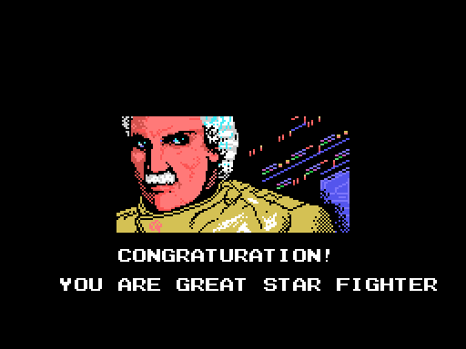
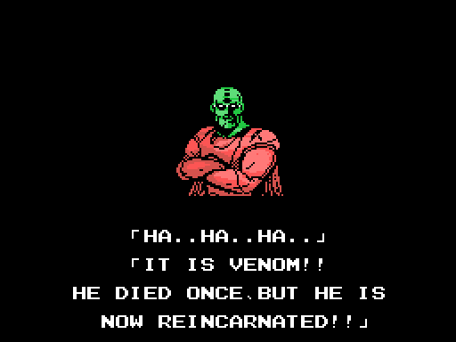

# The sequences

The still screens are **rebuilt from the ROM's bytes** and identical, pixel for pixel, to openMSX's VRAM at that moment. The animations are the VRAM and VDP registers of every openMSX frame, painted the way the TMS9918 paints them (`tools/anima.py`), one frame in three.

## The intro

*The whole intro, 32 seconds: the Konami logo on blue, the title with the
menu (1PLAYER, EXCHANGE and DUALPLAY), THE SAGA CONTINUES, KONAMI PRESENTS
and the title building up.*

If nothing is pressed, [the story](imagenes/historia.gif) follows (105
seconds): EMERGENCY, the warning from Latis, ZELOS-FORCE surrounding the
planet, the two ships with their pilots and «CAN THEY RESCUE PLANET LATIS?»,
and the title again with «THE FANTASTIC SPACE ADVENTURE COMMENCES». Then the
demo starts.

The still screens, each identical to the VRAM: [Konami](imagenes/konami.png),
[the title](imagenes/titulo.png),
[THE SAGA CONTINUES](imagenes/saga.png),
[KONAMI PRESENTS](imagenes/presents.png) and
[the title on its own](imagenes/titulo_solo.png).

## The two endings

The ending comes when boss 6 falls (`p11:B58D`). With *Nemesis 2* in the
other slot and `0xE30A` set, it is the good one (`p10:8F7F`); otherwise, the
other one.

*The good ending: «CONGRATURATION! YOU ARE GREAT STAR FIGHTER».*

Before it come «ZELOS FORCE HAS DISAPPEARED!!» and «...PEACE WILL RETURN TO
LATIS AGAIN!!».

*The other ending: VENOM shows up.*

The CRUSH BLOW fails, VENOM shows up («HE DIED ONCE, BUT HE IS NOW
REINCARNATED!!») and «THE CRUSH BLOW OPERATION TURNED OUT TO BE A FAILURE
AFTER ALL». Both end with THE END and EXTEND PLAY? Y/N.

| Ending | 1 | 2 | 3 | 4 | 5 |
|---|---|---|---|---|---|
| Good | [ZELOS FORCE](imagenes/final_bueno_1.png) | [PEACE](imagenes/final_bueno_2.png) | [the pilot](imagenes/final_bueno_3.png) | | |
| The other | [WHAT IS HAPPENED!?](imagenes/final_malo_1.png) | [VENOM](imagenes/final_malo_2.png) | [FAILURE](imagenes/final_malo_3.png) | [GO FOR THE FIGHT!!](imagenes/final_malo_4.png) | [THE END](imagenes/final_malo_5.png) |

*The screens of each ending, in order.*
