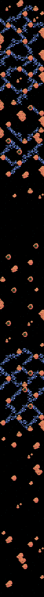
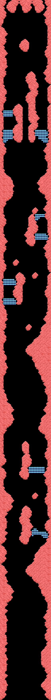
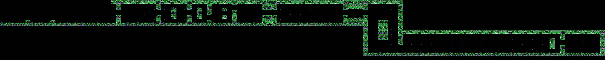
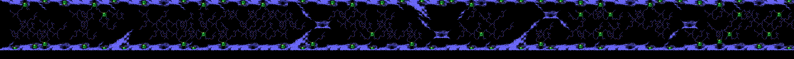
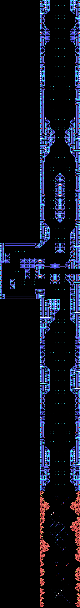
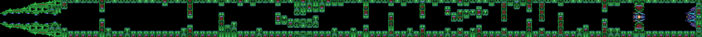

# The stages

**Seven stages**. Stages 1 and 2 always come first; stages 3, 4 and 5, in
whatever order the player picks; then stage 6. Stage 7 only exists with
*Nemesis 2* in the other slot.

The routes are **drawn from the bytes of the ROM**. The radar and the card are rebuilt from the ROM's bytes and identical, pixel for pixel, to openMSX's VRAM; the take-off is the VRAM of every frame of a game in openMSX, painted the way the TMS9918 paints it (`tools/anima.py`).

## The stages and their order

*The radar with the three planets.*

After stage 2, the game shows the radar with EIONEUS, LAVINIA and KIERKE,
and the player picks which one comes first: they are stages 3, 4 and 5, in
whatever order he chooses (`p10:988A`). There is a clock: if it reaches
zero, the game picks (`p10:9A43`). Stage 6 comes next. Stage 7, with
*Nemesis 2*, comes before stage 6 (`p10:8B7B`).

Before each stage come the take-off from the base and a title card
(`p10:8A20`):

*The take-off and the stage 1 card, 6 seconds. As stills, identical to the
VRAM: [the take-off](imagenes/despegue.png) and [the card](imagenes/rotulo.png).*

| Stage | Card | Subtitle |
|---|---|---|
| 1 | OPERATION ONE | -TOP FLIGHT SPEED TO LATIS- |
| 2 | OPERATION TWO | -CONDUCT TO SPACE STATION ZOT- |
| 3, 4, 5 | OPERATION THREE | -SET THE CRUSH BLOW SYSTEM- and the planet |
| 6 | OPERATION FOUR | -CRUSH SALAMANDER- |
| 7 | OPERATION X | -WRATH OF VENOM- |

In the Japanese version the subtitle of stages 3, 4 and 5 is
-SET THE LEEK SYSTEM- (`p15:BF5A`); the others are the same.

## The routes

Stages 2, 3 and 6 scroll vertically; the others, horizontally
(`p02:8921`). Each stage map is made of 4 x 4 character blocks
(`p13:6F4C`), but the route is not a straight strip: in three stages the
scroll stops and the screen moves through another map (`p00:4BE6`):

- in stage 1, at scroll 0x11F the view goes down 24 rows through the map at
  `p14:80FC`, carries on horizontally and at 0x1FF goes down another 24;
- in stage 4, at 0x1BF it goes down 24 rows through `p14:815C`;
- in stage 6, which goes up, at 0x14F it moves 32 columns to the left and
  at 0x167 back to the right, through `p14:818C`.

In stage 4, between scrolls 0x100 and 0x150, the base is barely visible:
only one frame in 64 dumps the map with its scenery (`p00:5FC5`,
`p01:6016`). In stages 1, 3, 6 and 7 the characters change half way
(`p00:5C77`), and in stages 4, 5 and 6 some of them animate on their own
(`p12:A4A9`).

### Stage 1

*Horizontal; goes down twice through another map.*

### Stage 2

*Vertical.*

### Stage 3

*Vertical.*

### Stage 4

*Horizontal; goes down once through another map, and the base is barely visible.*

### Stage 5

*Horizontal.*

### Stage 6

*Vertical; moves left and back.*

### Stage 7

*Horizontal; only with <i>Nemesis 2</i> in the other slot.*
