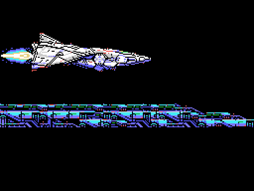

# El juego

## Las fases y su orden

Son siete. La 1 y la 2 van siempre primero. Después el juego enseña el
radar con los tres planetas, EIONEUS, LAVINIA y KIERKE, y el jugador elige
cuál hace antes: son las fases 3, 4 y 5, en el orden que él quiera
(`p10:988A`). Hay un reloj: si llega a cero, el juego elige solo
(`p10:9A43`). Detrás viene la 6. La 7 solo existe con *Nemesis 2* en la otra
ranura del MSX y va antes que la 6 (`p10:8B7B`).

Antes de cada fase sale el despegue desde la base y un rótulo
(`p10:8A20`):

| Fase | Rótulo | Subtítulo |
|---|---|---|
| 1 | OPERATION ONE | -TOP FLIGHT SPEED TO LATIS- |
| 2 | OPERATION TWO | -CONDUCT TO SPACE STATION ZOT- |
| 3, 4, 5 | OPERATION THREE | -SET THE CRUSH BLOW SYSTEM- y el planeta |
| 6 | OPERATION FOUR | -CRUSH SALAMANDER- |
| 7 | OPERATION X | -WRATH OF VENOM- |

En la versión japonesa el subtítulo de las fases 3, 4 y 5 es
-SET THE LEEK SYSTEM- (`p15:BF5A`); los demás son iguales.

## Los recorridos

La 2, la 3 y la 6 van en vertical; las demás, en horizontal (`p02:8921`).
El mapa de cada fase son bloques de 4 x 4 caracteres (`p13:6F4C`), pero el
recorrido no es una tira recta: en tres fases el scroll se para y la
pantalla se mueve por otro mapa (`p00:4BE6`):

- en la 1, al llegar al scroll 0x11F la vista baja 24 filas por el mapa de
  `p14:80FC`, sigue en horizontal y en 0x1FF vuelve a bajar otras 24;
- en la 4, en 0x1BF baja 24 filas por `p14:815C`;
- en la 6, que va hacia arriba, en 0x14F se va 32 columnas a la izquierda y
  en 0x167 vuelve a la derecha, por `p14:818C`.

Las imágenes montan cada recorrido entero, como el juego lo va metiendo en
la pantalla.

En la fase 4, entre los scrolls 0x100 y 0x150, la base casi no se ve: solo
uno de cada 64 cuadros vuelca el mapa con su decorado (`p00:5FC5`,
`p01:6016`). En las fases 1, 3, 6 y 7 los caracteres cambian a mitad de
camino (`p00:5C77`), y en las 4, 5 y 6 algunos se animan solos
(`p12:A4A9`).

## La nave

Son dos sprites de 16 x 16 y catorce posturas (`p09:A145`-`p09:A19F`,
dibujos en `p14:95F7`): recta, subiendo y bajando, las mismas con el escudo
delante y otras tantas para las fases verticales. El escudo aguanta los
golpes que cuenta IY+22 (`p02:960B`).

Hay dos naves: SABEL TIGER, la del piloto IGGY ROCK, y THRASHER, la de
ZOWIE SCOTT. El menú ofrece 1PLAYER, EXCHANGE y DUALPLAY, y la pantalla
SELECTION de `p12:B877` pregunta YES o NO a «PLAYER1 JOINT GAME».

## Los enemigos y los jefes

Hay 65 tipos de enemigo, cada uno con su ficha de 7 bytes (`p01:6C5D`).
Los de cada fase se ven con los fotogramas que usan.

| Fase | Jefe |
|---|---|
| 1 | el 1: un cerebro con dos tentáculos |
| 2 | el 2 |
| 3 | el 8, un nido en el techo que suelta arañas, y luego el 3 |
| 4 | el 4, después de una oleada (`p03:BD53`) |
| 5 | el 5 |
| 6 | el 7, un ojo dentro de una esfera, y luego el 6 |
| 7 | el núcleo fijo de `p12:A000`, en dos tramos |

El código de los ocho jefes está en el banco 11 (tabla `p01:6E89`).

## Los objetos y el final

En las fases 3, 5 y 6 hay objetos que se recogen (`p12:A5CE`). Al
recogerlos sale una pantalla con su resultado. Con el objeto 1 dice
«IN THE RUIN OF LATIS... YOU HAVE GOT A CRYSTAL BREEZE» y `p01:7B73` pone
`0xE30A` = 1.

El final llega al caer el jefe 6 (`p11:B58D`). Si están *Nemesis 2* en la
otra ranura y `0xE30A`, es el bueno (`p10:8F7F`): «ZELOS FORCE HAS
DISAPPEARED!!», «...PEACE WILL RETURN TO LATIS AGAIN!!» y el piloto,
«CONGRATURATION! YOU ARE GREAT STAR FIGHTER». Si no, el CRUSH BLOW falla,
aparece VENOM («HE DIED ONCE, BUT HE IS NOW REINCARNATED!!») y «THE CRUSH
BLOW OPERATION TURNED OUT TO BE A FAILURE AFTER ALL». Los dos acaban en
THE END y EXTEND PLAY? Y/N.

## Los textos

Están en el banco 15, con una tabla japonesa y otra inglesa según el byte
0x002B de la BIOS (`p10:944C`). Los ingleses, tal como vienen (con sus
erratas):

- «A WARNING SIGNAL FROM LATIS.», «ZELOS-FORCE SURROUNDING LATIS»,
  «BIGIN CRUSH-BLOW OPERATIONS! SPACE FORCE!! GET SET!!»,
  «HYPER SPACE FIGHTER», «SABEL TIGER / PILOT - IGGY ROCK»,
  «THRASHER / PILOT - ZOWIE SCOTT», «CAN THEY RESCUE PLANET LATIS?»
- entre fases: «ASSESS ARMS SUPPLY SITUATION THEN DICIDE WITHIN TIME
  LIMIT.», «WE HAVE SET ALL OF THE CRUSH BLOW SYSTEMS.», «OK, SWITCH ON!!»,
  «WAIT! PLEASE REMEMBER THE PREDICTION»
- la profecía, en cuatro capítulos: el diablo que vino de la esfera y su
  escudo de cobre, la esfera enorme y la bola brillante, el gran diablo y su
  núcleo, y el diablo verde de cinco ojos que solo muere con el cristal.
