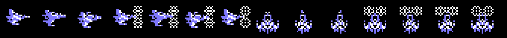
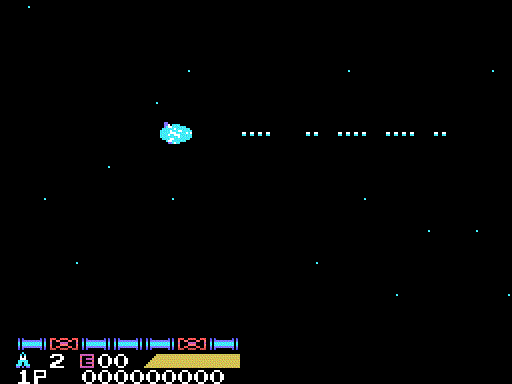
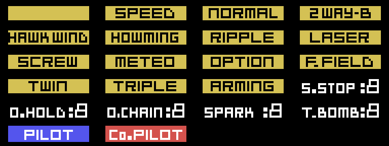
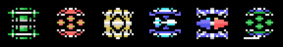

# El juego

**Siete fases**. La 1 y la 2 van siempre primero; la 3, la 4 y la 5, en el orden que elija el
jugador; luego la 6. La 7 solo existe con *Nemesis 2* en la otra ranura.

Todas las imágenes de esta página salen de `tools/imagenes.py`. Las
pantallas fijas de la presentación, el radar y los finales están **rehechas
con los bytes de la ROM** e iguales, píxel a píxel, a la VRAM de openMSX en
ese momento; los enemigos, los jefes, las piezas de las armas y los objetos se
dibujan con los dibujos de la ROM. Las animaciones son la VRAM y los registros
del VDP de cada cuadro de una partida en openMSX, pintados como los pinta el
TMS9918 (`tools/anima.py`), un cuadro de cada tres.

## La presentación

*La presentación entera, 32 segundos: el logotipo de Konami sobre azul, el
título con el menú (1PLAYER, EXCHANGE y DUALPLAY), THE SAGA CONTINUES,
KONAMI PRESENTS y el título que se monta.*

Si no se pulsa nada, sigue [la historia](../imagenes/historia.gif) (105
segundos): EMERGENCY, el aviso de Latis, ZELOS-FORCE rodeando el planeta,
las dos naves con sus pilotos y «CAN THEY RESCUE PLANET LATIS?», y otra vez
el título con «THE FANTASTIC SPACE ADVENTURE COMMENCES». Después empieza la
demostración.

Las pantallas fijas, cada una igual a la VRAM: [Konami](../imagenes/konami.png),
[el título](../imagenes/titulo.png),
[THE SAGA CONTINUES](../imagenes/saga.png),
[KONAMI PRESENTS](../imagenes/presents.png) y
[el título solo](../imagenes/titulo_solo.png).

## Las fases y su orden

*El radar con los tres planetas.*

Tras la fase 2, el juego enseña el radar con EIONEUS, LAVINIA y KIERKE, y el
jugador elige cuál hace antes: son las fases 3, 4 y 5, en el orden que él
quiera (`p10:988A`). Hay un reloj: si llega a cero, el juego elige solo
(`p10:9A43`). Detrás viene la 6. La 7, con *Nemesis 2*, va antes que la 6
(`p10:8B7B`).

Antes de cada fase sale el despegue desde la base y un rótulo (`p10:8A20`):

*El despegue y el rótulo de la fase 1, 6 segundos. Fijos, iguales a la VRAM:
[el despegue](../imagenes/despegue.png) y [el rótulo](../imagenes/rotulo.png).*

| Fase | Rótulo | Subtítulo |
|---|---|---|
| 1 | OPERATION ONE | -TOP FLIGHT SPEED TO LATIS- |
| 2 | OPERATION TWO | -CONDUCT TO SPACE STATION ZOT- |
| 3, 4, 5 | OPERATION THREE | -SET THE CRUSH BLOW SYSTEM- y el planeta |
| 6 | OPERATION FOUR | -CRUSH SALAMANDER- |
| 7 | OPERATION X | -WRATH OF VENOM- |

En la versión japonesa el subtítulo de las fases 3, 4 y 5 es
-SET THE LEEK SYSTEM- (`p15:BF5A`); los demás son iguales.

## Los recorridos

*La fase 1 entera, como el juego la va metiendo en la pantalla: baja dos
veces por otro mapa.*

La 2, la 3 y la 6 van en vertical; las demás, en horizontal (`p02:8921`).
El mapa de cada fase son bloques de 4 x 4 caracteres (`p13:6F4C`), pero el
recorrido no es una tira recta: en tres fases el scroll se para y la
pantalla se mueve por otro mapa (`p00:4BE6`):

- en la 1, al llegar al scroll 0x11F la vista baja 24 filas por el mapa de
  `p14:80FC`, sigue en horizontal y en 0x1FF vuelve a bajar otras 24;
- en la 4, en 0x1BF baja 24 filas por `p14:815C`;
- en la 6, que va hacia arriba, en 0x14F se va 32 columnas a la izquierda y
  en 0x167 vuelve a la derecha, por `p14:818C`.

| Fase | 1 | 2 | 3 | 4 | 5 | 6 | 7 |
|---|---|---|---|---|---|---|---|
| Sentido | [horizontal](../imagenes/recorrido_f1.png) | [vertical](../imagenes/recorrido_f2.png) | [vertical](../imagenes/recorrido_f3.png) | [horizontal](../imagenes/recorrido_f4.png) | [horizontal](../imagenes/recorrido_f5.png) | [vertical](../imagenes/recorrido_f6.png) | [horizontal](../imagenes/recorrido_f7.png) |

*Cada enlace lleva al recorrido entero de su fase.*

En la fase 4, entre los scrolls 0x100 y 0x150, la base casi no se ve: solo
uno de cada 64 cuadros vuelca el mapa con su decorado (`p00:5FC5`,
`p01:6016`). En las fases 1, 3, 6 y 7 los caracteres cambian a mitad de
camino (`p00:5C77`), y en las 4, 5 y 6 algunos se animan solos
(`p12:A4A9`).

## La nave

*Las catorce posturas.*

Son dos sprites de 16 x 16 y catorce posturas (`p09:A145`-`p09:A19F`,
dibujos en `p14:95F7`): recta, subiendo y bajando, las mismas con el escudo
delante y otras tantas para las fases verticales. El escudo aguanta los
golpes que cuenta IY+22 (`p02:960B`).

Hay dos naves: SABEL TIGER, la del piloto IGGY ROCK, y THRASHER, la de
ZOWIE SCOTT. La pantalla SELECTION de `p12:B877` pregunta YES o NO a
«PLAYER1 JOINT GAME».

## Las armas

*Las cuatro opciones, que siguen a la nave por donde ha pasado.*

Abajo, el marcador tiene siete casillas (`p00:5D8E`). Cada cápsula 0x29
avanza la casilla elegida (`p02:97C9`) y el segundo botón la activa
(`p02:8929`): la casilla sube su arma un nivel, con su rutina de la tabla
`p02:8967`. A la derecha, una ventana de 5 caracteres dice qué se lleva: una
pieza de la tabla `p14:8849`, 35 bytes de dibujo y uno de color, elegida por
la casilla y su nivel (`p00:5E52`).

*Las 22 piezas, dibujadas desde la ROM. Las de las siete casillas son
iguales a las que pinta el juego en openMSX al coger cada cápsula
(`tools/armas.py coteja`).*

| Casilla | Nivel 1 | Nivel 2 | Nivel 3 |
|---|---|---|---|
| 1 | SPEED, siete veces | | |
| 2 | [NORMAL](../imagenes/arma_normal.gif) | [TWIN](../imagenes/arma_twin.gif) | [TRIPLE](../imagenes/arma_triple.gif) |
| 3 | [2WAY-B](../imagenes/arma_2way.gif) | [HAWK WING](../imagenes/arma_hawkwing.gif) | [HOWMING](../imagenes/arma_howming.gif) |
| 4 | [RIPPLE](../imagenes/arma_ripple.gif) | [ARMING](../imagenes/arma_arming.gif) | |
| 5 | [LASER](../imagenes/arma_laser.gif) | [METEO](../imagenes/arma_meteo.gif) | [SCREW](../imagenes/arma_screw.gif) |
| 6 | [OPTION](../imagenes/arma_option.gif), hasta cuatro (tres con dos jugadores) | | |
| 7 | [F.FIELD](../imagenes/arma_ffield.gif), diez golpes | | |

*Cada enlace lleva a la nave disparando con esa arma.*

Las casillas 2, 4 y 5 son el arma principal (IY+40: 1 NORMAL, 2 RIPPLE, 3
LASER, 4 SCREW, 5 METEO, 6 TWIN y 7 TRIPLE) y la 3 y el ARMING, la del
panel (IY+41: de 1 a 3 los misiles y 4 el ARMING). El segundo y el tercer
nivel solo los da el juego con las dos naves juntas, en el estado 3 o 4
(`p02:8995`), cuando la ventana dice PILOT o Co.PILOT. Para los GIF, el arma
se ha puesto a mano en la RAM (0xE340 y 0xE341); las opciones y el F.FIELD
se activan como en el juego. El ARMING sale hacia donde se empuja el mando
(`p03:B43F`): con la nave quieta no dispara.

## Las cápsulas y los objetos

*Los objetos del 1 al 6, dibujados con las rachas de `p09:A331`. El 2 y el
3 son iguales, a 0 bytes, a la VRAM de dos partidas en openMSX.*

Hay tres cápsulas (`p02:9670`):

- la **0x29** avanza la casilla del marcador;
- la **0x2A** da una bomba (IY+42, `p02:9806`) y la ventana dice T.BOMB:
  mientras queden, el botón suelta [bombas](../imagenes/arma_bomba.gif) en
  vez del arma del panel (`p03:A962`);
- la **0x35** suma uno a IY+1B; al llegar a 15 vuelve a 0 y sube IY+10, y con
  IY+10 en 7 da una vida más (`p02:974A`).

La 0x29 y la 0x2A están en la hoja de los
[enemigos de la fase 4](../imagenes/enemigos_f4.png). La 0x35 no ha salido
en ninguna de las partidas grabadas, y no se dibuja aquí.

Algunos enemigos sueltan, al romperlos, uno de estos objetos (`p01:7C36`;
con un jugador, del 1 al 4). Son cuatro caracteres en el decorado
(`p02:8B97`) y dan 30 puntos al cogerlos (`p02:9909`). Cada uno pone un reloj
(0xE630 el modo, 0xE631 el tiempo) y su pieza en la ventana (`p02:991E`):

| Objeto | En la ventana | El reloj |
|---|---|---|
| 1 | S.STOP | modo 1, 0x10 |
| 2 | O.HOLD | modo 2, 0x15, e IY+34 = 1 |
| 3 | SPARK | modo 3 |
| 4 | | nada |
| 5 | | modo 5, 0x10, en el otro jugador |
| 6 | O.CHAIN | modo 6, 0x30 |

En las fases 3, 5 y 6 hay además objetos que se recogen (`p12:A5CE`). Al
recogerlos sale una pantalla con su resultado. Con el objeto 1 dice
«IN THE RUIN OF LATIS... YOU HAVE GOT A CRYSTAL BREEZE» y `p01:7B73` pone
`0xE30A` = 1.

## Los enemigos

*Los enemigos de la fase 1, con los fotogramas que usan.*

Hay 65 tipos de enemigo, cada uno con su ficha de 7 bytes (`p01:6C5D`).

| Fase | 1 | 2 | 3 | 4 | 5 | 6 | 7 |
|---|---|---|---|---|---|---|---|
| Enemigos | [fase 1](../imagenes/enemigos_f1.png) | [fase 2](../imagenes/enemigos_f2.png) | [fase 3](../imagenes/enemigos_f3.png) | [fase 4](../imagenes/enemigos_f4.png) | [fase 5](../imagenes/enemigos_f5.png) | [fase 6](../imagenes/enemigos_f6.png) | [fase 7](../imagenes/enemigos_f7.png) |

## Los jefes

*El jefe 1, un cerebro con dos tentáculos.*

El código de los ocho jefes está en el banco 11 (tabla `p01:6E89`). El
cartucho no les da nombre: ni los textos ingleses ni los japoneses nombran a
ninguno. La profecía solo habla de «THE DEVIL» con su escudo de cobre, «THE
HUGE SPHERE», «THE GREAT DEVIL» y su núcleo, y «THE FIVE EYED GREEN DEVIL».

| Fase | Jefe |
|---|---|
| 1 | [el 1](../imagenes/jefe_1.png): un cerebro con dos tentáculos |
| 2 | [el 2](../imagenes/jefe_2.png) |
| 3 | [el 8](../imagenes/jefe_8.png), un nido en el techo que suelta arañas, y luego [el 3](../imagenes/jefe_3.png) |
| 4 | [el 4](../imagenes/jefe_4.png), después de una oleada (`p03:BD53`) |
| 5 | [el 5](../imagenes/jefe_5.png) |
| 6 | [el 7](../imagenes/jefe_7.png), un ojo dentro de una esfera, y luego [el 6](../imagenes/jefe_6.png) |
| 7 | [el núcleo](../imagenes/jefe_nucleo.png) fijo de `p12:A000`, en dos tramos |

## Los dos finales

El final llega al caer el jefe 6 (`p11:B58D`). Si están *Nemesis 2* en la
otra ranura y `0xE30A`, es el bueno (`p10:8F7F`); si no, el otro.

*El final bueno: «CONGRATURATION! YOU ARE GREAT STAR FIGHTER».*

Antes salen «ZELOS FORCE HAS DISAPPEARED!!» y «...PEACE WILL RETURN TO
LATIS AGAIN!!».

*El otro final: aparece VENOM.*

El CRUSH BLOW falla, aparece VENOM («HE DIED ONCE, BUT HE IS NOW
REINCARNATED!!») y «THE CRUSH BLOW OPERATION TURNED OUT TO BE A FAILURE
AFTER ALL». Los dos acaban en THE END y EXTEND PLAY? Y/N.

| Final | 1 | 2 | 3 | 4 | 5 |
|---|---|---|---|---|---|
| Bueno | [ZELOS FORCE](../imagenes/final_bueno_1.png) | [PEACE](../imagenes/final_bueno_2.png) | [el piloto](../imagenes/final_bueno_3.png) | | |
| El otro | [WHAT IS HAPPENED!?](../imagenes/final_malo_1.png) | [VENOM](../imagenes/final_malo_2.png) | [FAILURE](../imagenes/final_malo_3.png) | [GO FOR THE FIGHT!!](../imagenes/final_malo_4.png) | [THE END](../imagenes/final_malo_5.png) |

*Las pantallas de cada final, en orden.*

## Los textos

Están en el banco 15, con una tabla japonesa y otra inglesa según el byte
0x002B de la BIOS (`p10:944C`). Los ingleses, tal como vienen (con sus
erratas):

- «A WARNING SIGNAL FROM LATIS.», «ZELOS-FORCE SURROUNDING LATIS»,
  «BIGIN CRUSH-BLOW OPERATIONS! SPACE FORCE!! GET SET!!»,
  «HYPER SPACE FIGHTER», «SABEL TIGER / PILOT - IGGY ROCK»,
  «THRASHER / PILOT - ZOWIE SCOTT», «CAN THEY RESCUE PLANET LATIS?»
- entre fases: «ASSESS ARMS SUPPLY SITUATION THEN DICIDE WITHIN TIME
  LIMIT.», «WE HAVE SET ALL OF THE CRUSH BLOW SYSTEMS.», «OK, SWITCH ON!!»,
  «WAIT! PLEASE REMEMBER THE PREDICTION»
- la profecía, en cuatro capítulos: el diablo que vino de la esfera y su
  escudo de cobre, la esfera enorme y la bola brillante, el gran diablo y su
  núcleo, y el diablo verde de cinco ojos que solo muere con el cristal.
