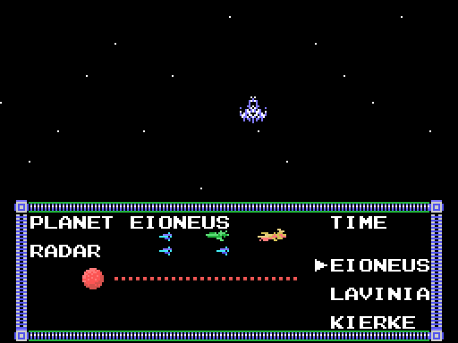
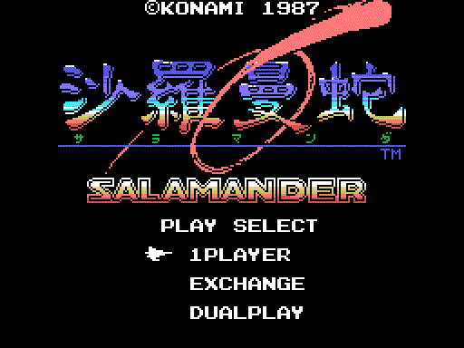
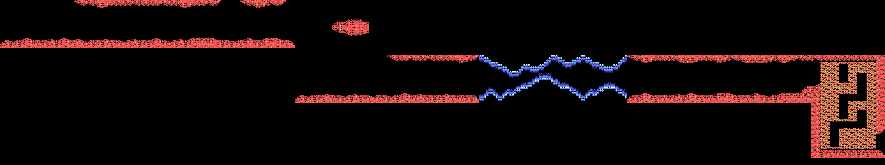

# Las fases

**Siete fases**. La 1 y la 2 van siempre primero; la 3, la 4 y la 5, en el orden que elija el
jugador; luego la 6. La 7 solo existe con *Nemesis 2* en la otra ranura.

Los recorridos están **dibujados desde los bytes de la ROM**. El radar y el rótulo están rehechos con los bytes de la ROM e iguales, píxel a píxel, a la VRAM de openMSX; el despegue es la VRAM de cada cuadro de una partida en openMSX, pintada como la pinta el TMS9918 (`tools/anima.py`).

## Las fases y su orden

*El radar con los tres planetas.*

Tras la fase 2, el juego enseña el radar con EIONEUS, LAVINIA y KIERKE, y el
jugador elige cuál hace antes: son las fases 3, 4 y 5, en el orden que él
quiera (`p10:988A`). Hay un reloj: si llega a cero, el juego elige solo
(`p10:9A43`). Detrás viene la 6. La 7, con *Nemesis 2*, va antes que la 6
(`p10:8B7B`).

Antes de cada fase sale el despegue desde la base y un rótulo (`p10:8A20`):

*El despegue y el rótulo de la fase 1, 6 segundos. Fijos, iguales a la VRAM:
[el despegue](../imagenes/despegue.png) y [el rótulo](../imagenes/rotulo.png).*

| Fase | Rótulo | Subtítulo |
|---|---|---|
| 1 | OPERATION ONE | -TOP FLIGHT SPEED TO LATIS- |
| 2 | OPERATION TWO | -CONDUCT TO SPACE STATION ZOT- |
| 3, 4, 5 | OPERATION THREE | -SET THE CRUSH BLOW SYSTEM- y el planeta |
| 6 | OPERATION FOUR | -CRUSH SALAMANDER- |
| 7 | OPERATION X | -WRATH OF VENOM- |

En la versión japonesa el subtítulo de las fases 3, 4 y 5 es
-SET THE LEEK SYSTEM- (`p15:BF5A`); los demás son iguales.

## Los recorridos

*La fase 1 entera, como el juego la va metiendo en la pantalla: baja dos
veces por otro mapa.*

La 2, la 3 y la 6 van en vertical; las demás, en horizontal (`p02:8921`).
El mapa de cada fase son bloques de 4 x 4 caracteres (`p13:6F4C`), pero el
recorrido no es una tira recta: en tres fases el scroll se para y la
pantalla se mueve por otro mapa (`p00:4BE6`):

- en la 1, al llegar al scroll 0x11F la vista baja 24 filas por el mapa de
  `p14:80FC`, sigue en horizontal y en 0x1FF vuelve a bajar otras 24;
- en la 4, en 0x1BF baja 24 filas por `p14:815C`;
- en la 6, que va hacia arriba, en 0x14F se va 32 columnas a la izquierda y
  en 0x167 vuelve a la derecha, por `p14:818C`.

| Fase | 1 | 2 | 3 | 4 | 5 | 6 | 7 |
|---|---|---|---|---|---|---|---|
| Sentido | [horizontal](../imagenes/recorrido_f1.png) | [vertical](../imagenes/recorrido_f2.png) | [vertical](../imagenes/recorrido_f3.png) | [horizontal](../imagenes/recorrido_f4.png) | [horizontal](../imagenes/recorrido_f5.png) | [vertical](../imagenes/recorrido_f6.png) | [horizontal](../imagenes/recorrido_f7.png) |

*Cada enlace lleva al recorrido entero de su fase.*

En la fase 4, entre los scrolls 0x100 y 0x150, la base casi no se ve: solo
uno de cada 64 cuadros vuelca el mapa con su decorado (`p00:5FC5`,
`p01:6016`). En las fases 1, 3, 6 y 7 los caracteres cambian a mitad de
camino (`p00:5C77`), y en las 4, 5 y 6 algunos se animan solos
(`p12:A4A9`).
