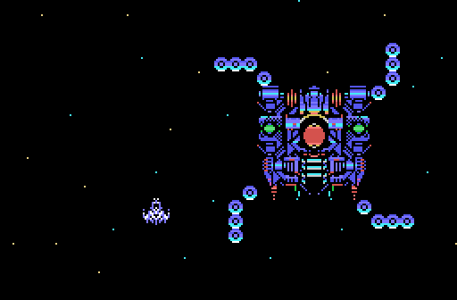
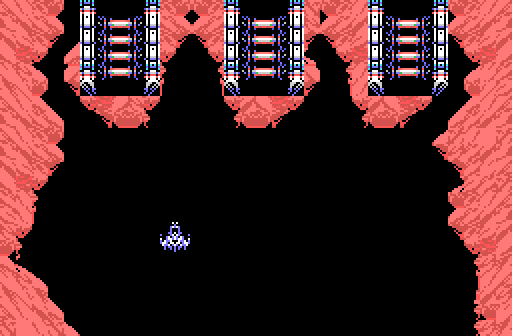
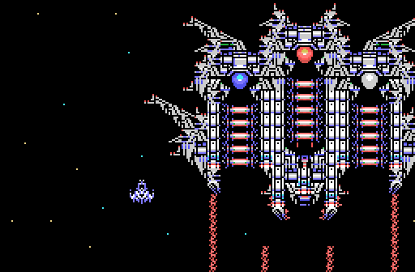
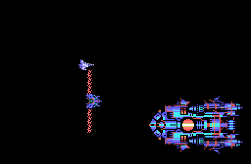
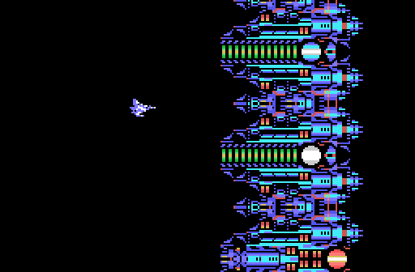
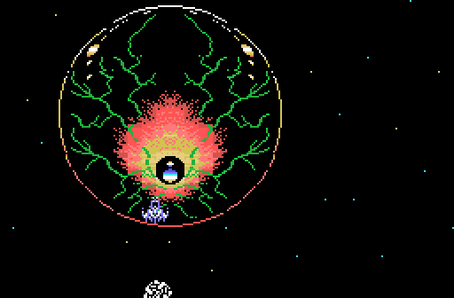
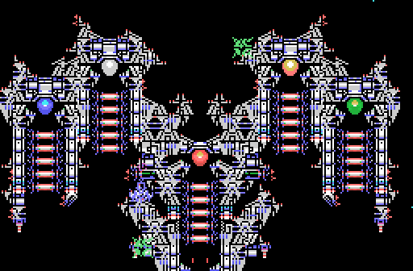
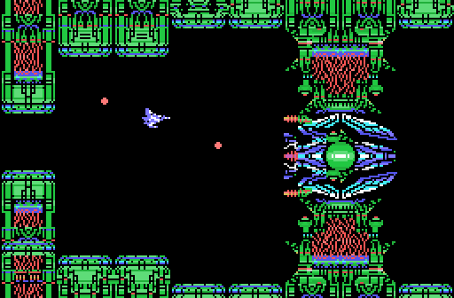

# Los jefes

Los jefes se pintan con **los caracteres y los dibujos de la ROM** sobre la disposición de un volcado de openMSX (`tools/jefes.py`).

El código de los ocho jefes está en el banco 11 (tabla `p01:6E89`). El
cartucho no les da nombre: ni los textos ingleses ni los japoneses nombran a
ninguno. La profecía solo habla de «THE DEVIL» con su escudo de cobre, «THE
HUGE SPHERE», «THE GREAT DEVIL» y su núcleo, y «THE FIVE EYED GREEN DEVIL».

### Fase 1: el jefe 1

*Un cerebro con dos tentáculos.*

### Fase 2: el jefe 2

### Fase 3: el jefe 8

*Un nido en el techo que suelta arañas; detrás viene el 3.*

### Fase 3: el jefe 3

### Fase 4: el jefe 4

*Sale después de una oleada (`p03:BD53`).*

### Fase 5: el jefe 5

### Fase 6: el jefe 7

*Un ojo dentro de una esfera; detrás viene el 6.*

### Fase 6: el jefe 6

### Fase 7: el núcleo

*Fijo, de `p12:A000`, en dos tramos.*
